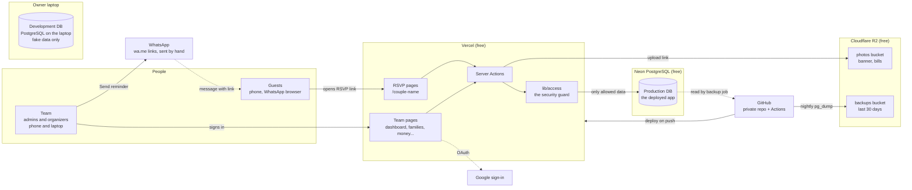
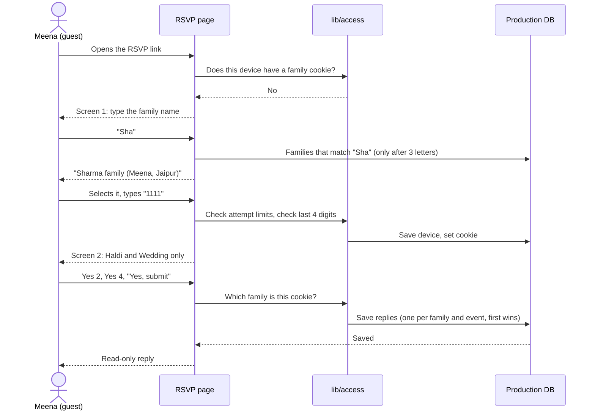
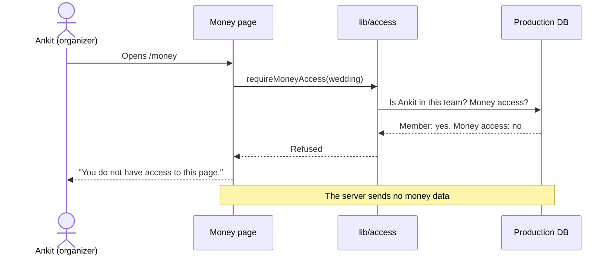
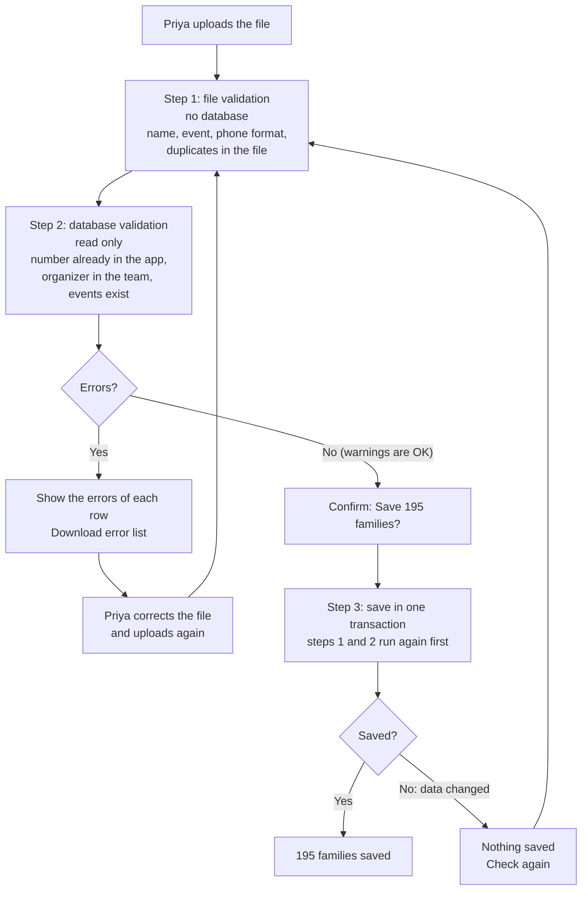
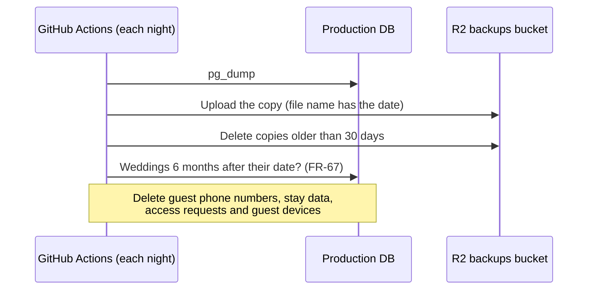

# ShaadiDesk: System Architecture

Date: 2026-10-24
Status: Approved by the owner on 2026-10-24. The PRD and the design document use this stack.
Language: ASD-STE100 Simplified Technical English (STE)
Source documents: PRD (`docs/prd/2026-10-16-shaadidesk-prd.md`, `docs/prd/2026-10-16-shaadidesk-prd-part-2.md`) and design document (`docs/superpowers/specs/2026-10-16-wedding-management-design.md`).

**Labels:** `[Confirmed]` = the owner decided. `[Proposed]` = the writer recommends; the owner must approve it. `TBD` = not decided.

## 1. Stack

| Part | Choice | Why | Label |
|---|---|---|---|
| App | Next.js (App Router) with TypeScript, on Node.js | Server-rendered pages give a fast first load and a correct WhatsApp link preview. One codebase for pages and server code. Types catch errors early. | `[Confirmed]` |
| Server code | Next.js Server Actions and server components. No Express. | Express needs a second project and usually a host that sleeps. | `[Confirmed]` |
| Database | PostgreSQL. Production: Neon (free tier). Development: normal PostgreSQL on the laptop (Homebrew, version 17). | The data has many links and strict rules: unique replies, cascades, transactions, exact money. Neon wakes in less than approximately 1 second. | `[Confirmed]` |
| Database tool | Prisma 7, with the `pg` driver adapter | Type-safe queries and migrations. Supports transactions, unique constraints and cascades. The owner selected it on 2026-10-25 (instead of Drizzle). | `[Confirmed]` |
| Validation | Zod (form inputs, Server Actions, import rows, environment variables) | One schema runs in the browser and on the server. | `[Confirmed]` |
| Node.js version | The newest LTS version that Vercel supports, set in `.nvmrc`. The owner uses `nvm`. | The laptop and Vercel run the same version. | `[Confirmed]` |
| Files and backups | Cloudflare R2, with the S3 API | 10 GB free with no time limit. The same code operates with AWS S3 later. | `[Confirmed]` |
| Hosting | Vercel (free plan), at `<name>.vercel.app/<couple>` | Serverless functions start fast. Preview link for each branch. The free plan is for non-commercial use. | `[Confirmed]` |
| Code and jobs | Private GitHub repository and GitHub Actions | Automatic deploy to Vercel. Nightly backup and cleanup jobs. | `[Confirmed]` |
| Team sign-in | Better Auth with Google, sessions in PostgreSQL (through its Prisma adapter) | A removed organizer or a changed money switch applies at the next click. Changed from Auth.js on 2026-10-30: Auth.js v5 is still a beta, and its Prisma adapter supports only up to Prisma 6. Better Auth is stable (1.7) and supports Next.js 16 and Prisma 7. | `[Confirmed]` |
| User interface | Tailwind CSS and shadcn/ui | Large text, strong contrast and big tap targets are easy (NFR-21 to NFR-24). | `[Confirmed]` |
| Tests | Small Vitest tests, only for the access rules and the import rules. No Playwright. No CI for now. | The parts with the highest risk get tests. The rest is checked by hand. Owner decision, 2026-10-25. | `[Confirmed]` |
| Error log | Vercel logs. Sentry free plan only if necessary. | No setup. | `[Confirmed]` |

## 2. System diagram



**Rules in this diagram:**
- Guests never sign in. A cookie on the guest device links the device to one family.
- Every page and every Server Action goes through `lib/access` before it reads or writes the database (FR-64).
- The app never sends WhatsApp messages. It only opens a `wa.me` link. A person pushes "send".
- The backup job runs on GitHub, not on Vercel. A problem on Vercel does not stop the backups.
- The laptop uses its own PostgreSQL, with fake data only. Neon is used only by the deployed app and the nightly backup.

## 3. Main flows

### 3.1 A guest replies (Meena Aunty)



### 3.2 Ankit opens the money page (no money access)



### 3.3 Excel import (0 errors before save)



- The server reads the file. The app does not keep the file after the import, because it has phone numbers. `[Confirmed]`
- Save is possible only with 0 errors. Warnings (for example, no phone number) do not stop the save. `[Confirmed]`
- A second import with families that are already in the app (same family name and same number): the app skips them with the note "already in the app". A number that a different family uses is an error. `[Confirmed]`

### 3.4 Nightly jobs



## 4. Folder structure

Decided by the owner on 2026-10-30. `[Confirmed]` It follows the Next.js 16 project structure guide (`node_modules/next/dist/docs/01-app/01-getting-started/02-project-structure.md`) and the API design (`docs/architecture/2026-10-29-shaadidesk-api-design.md`).

```
app/
  layout.tsx                     outer frame of every page: fonts, colours
  page.tsx                       "/": signed in -> /weddings, else -> /sign-in
  globals.css
  (guest)/                       guest pages: no menu, the couple's colour
    [couple]/
      page.tsx                   /priya-rahul: Screen 1 (find family) or Screen 2 (reply)
      _components/               pieces used only on this page (digit boxes, event card)
  (auth)/
    sign-in/page.tsx             /sign-in: "Continue with Google"
  (team)/                        team pages: sidebar on a laptop, bottom bar on a phone
    weddings/
      page.tsx                   /weddings: My weddings
      new/page.tsx               /weddings/new: Make a wedding
    w/[weddingId]/
      layout.tsx                 frame with the menu; may call requireMember for the menu, but a layout does not protect its pages (every page and action calls lib/access itself)
      page.tsx                   Home (dashboard)
      families/                  page.tsx (list), new/page.tsx, [familyId]/page.tsx
      my-families/page.tsx       My families (organizers)
      import/                    page.tsx, template/route.ts (Excel template)
      events/                    page.tsx, new/page.tsx, [eventId]/page.tsx
      team/page.tsx
      settings/page.tsx          settings and the RSVP link
      preview/page.tsx           "See it as a guest sees it"
      more/page.tsx              the "More" tab on phones
      export/[file]/route.ts     families.csv, replies.csv, team.csv
  api/auth/[...all]/route.ts     Google sign-in addresses (Better Auth)

components/
  ui/                            shadcn pieces (button, input, card)
  layout/                        sidebar, bottom bar, top bar, TEST badge
  shared/                        status chip, event dot, empty state, page shell

lib/
  access/                        the security guard (FR-64)
  auth/                          Better Auth setup (Google)
  db/                            Prisma client (the `db` object)
  weddings/ events/ team/ families/ import/ rsvp/ tracking/ dashboard/ export/
                                 each: queries.ts (read), actions.ts ("use server"), schemas.ts (Zod)
  phone/ time/ limits.ts storage/  helpers, each made inside the first feature that needs it
  result.ts                      the Result type and the error codes
  env.ts  utils.ts

prisma/schema/                   schema files (base, enums, team, events, guests)
prisma/migrations/               migration files
scripts/                         sample file generator, backup
samples/                         sample Excel files with fake families
tests/access/  tests/import/     small Vitest tests
.github/workflows/               nightly backup and cleanup
```

**Rules:**
- `app/` holds only pages and routes. Server code is in `lib/<area>/`. One area (for example families) has its read functions, actions and Zod schemas in one folder.
- `(guest)`, `(auth)` and `(team)` are route groups. The name in round brackets is not part of the address. Each group has its own frame (layout).
- A component that only one page uses is in the `_components/` folder of that page. The underscore tells Next.js that the folder is not an address. When a second page needs the component, it moves to `components/shared/`.
- Team addresses are `/w/<wedding id>/...`. The guest address is `/<couple>`. Screen 1 and Screen 2 are one page: the server reads the family cookie and shows the correct screen.
- No `src/` folder. `proxy.ts` is not used for security: all checks are in `lib/access`.
- Reserved link names: because the guest page is `/<couple>`, a couple cannot use a top-level name (`weddings`, `w`, `sign-in`, `api` and the other folders in `app/`) as the RSVP link name.
- Folders are made when their feature is built, not before.

## 5. Environments

| | Production | Development |
|---|---|---|
| Used by | Real guests and the team | The owner, while building |
| Database | Neon (one `main` branch) | Normal PostgreSQL on the laptop, filled with approximately 500 fake families |
| Address | `<name>.vercel.app` | `localhost:3000` (Vercel preview deployments are off, because they have no database) |
| Database changes | After development | First |

Decided on 2026-10-25: the development database is a normal PostgreSQL on the laptop (not Docker, not a Neon branch). Neon is normal PostgreSQL too, so the code is the same. Only the connection string changes.

Label: `[Confirmed]`.

## 6. Technical rules

| # | Rule | Label |
|---|---|---|
| 1 | Guest access: an `httpOnly` cookie with a random device code, checked against `guest_devices`. | `[Confirmed]` |
| 2 | Attempt limits are kept in a PostgreSQL table. No Redis. | `[Confirmed]` |
| 3 | Every page and Server Action calls `lib/access` first. Hiding a button is not protection. | `[Confirmed]` |
| 4 | Phone numbers are kept in one standard format (`libphonenumber-js`). | `[Confirmed]` |
| 5 | Photos are made smaller in the browser (approximately 300 KB) and uploaded to R2 directly. Bills are private. The banner is public. | `[Confirmed]` |
| 6 | Times are saved in UTC and shown in India time. | `[Confirmed]` |
| 7 | Money is saved as whole paise (`bigint`) and shown in the Indian format, for example ₹1,50,000. | `[Confirmed]` |
| 8 | Secrets (database password, R2 keys, Google keys) are only in Vercel environment variables and GitHub Secrets. Never in the code. | `[Confirmed]` |

## 7. Open questions

| # | Question | Proposal |
|---|---|---|
| 1 | Is the name `shaadidesk.vercel.app` available? | Check on day 1, before the card is designed. |
| 2 | Does Google need a review to publish the sign-in project (basic scopes only)? | Check at setup. |
