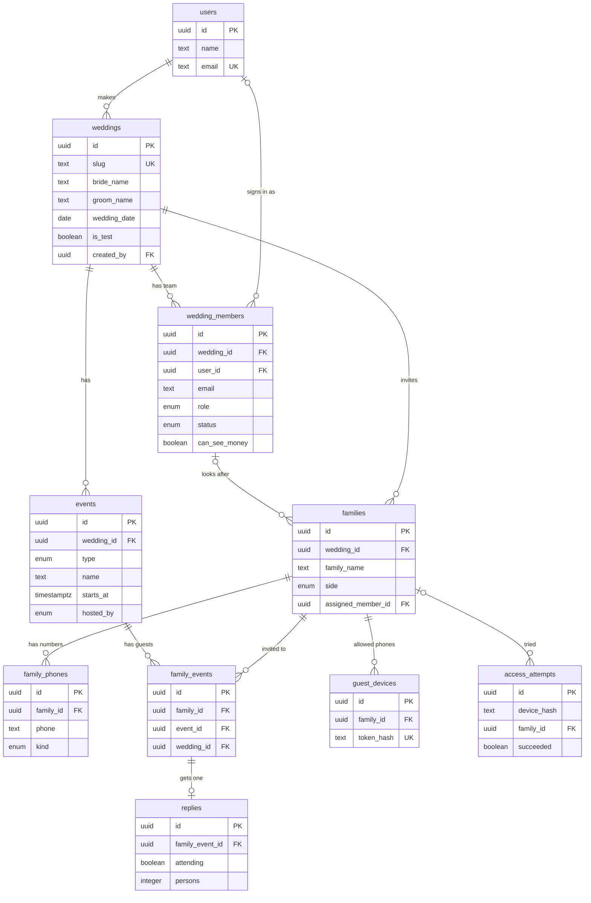

# ShaadiDesk: Database Design (Wave 1)

Date: 2026-10-25  
Status: **Draft 6 (2026-10-30). All open points are decided. The schema folder `prisma/schema/` is written from this design. Two migrations are applied to the local database. Still to come: the sign-in tables, the lowercase email checks (step 4.2) and `access_attempts.ip_hash` (step 7.3).**  
Sources: PRD Sections 8 and 12, design document Section 8.1, build plan step 2.2.

Nothing in this document is built yet. A visual version of this document, with the same diagram, is on the Database Design page: https://claude.ai/artifact/CJiwX1Y1DWcPP2Yzu3agwr

## How to read the diagram

- A **box** is a table. A **line** between two boxes means "belongs to".
- Read each line with its words, for example: *one wedding has many events*.
- Line ends: `||` = exactly one, `o|` = zero or one, `o{` = zero or many.
- **PK** = primary key (the table's ID). **FK** = foreign key (points to another table). **UK** = unique (no two rows can have the same value).
- The diagram shows the key columns only. The sections below list every column.

## Diagram

**Links that are not drawn** (to keep the diagram clear):

- `families.invitation_sent_by` → `wedding_members.id`: who ticked "Invitation sent"
- `replies.updated_by` → `wedding_members.id`: which team member changed a reply
- `family_phones.wedding_id` → `weddings.id`: a copy of the family's wedding, for the unique-number rule
- `family_events.wedding_id` → `weddings.id`: the wedding of the family and of the event, checked by the database

## One example, step by step

The Priya & Rahul test wedding, and what each step stores:

1. Priya makes the wedding. → table `weddings`: One row: slug priya-rahul, bride Priya, groom Rahul, a test wedding.
2. She adds the team. → table `wedding_members`: Rows for Priya and Dad (admins), Rohan (organizer), and Ankit (organizer, status pending: user_id is empty).
3. She adds the events. → table `events`: Haldi on 12 Jan and the Wedding on 15 Jan.
4. She imports the guest list. The Sharma family is one row. → table `families`: Assigned to Rohan. Marked sent on 2 Dec.
5. Their two phone numbers are saved. → table `family_phones`: Meena's number is primary. Her son's number is secondary.
6. The Sharma family is invited to Haldi and the Wedding. → table `family_events`: Two rows: Sharma + Haldi, Sharma + Wedding.
7. Meena opens the link and types 5555, then 1111. → table `access_attempts`: One failed try and one that worked.
8. Her phone is remembered. → table `guest_devices`: One row for the Sharma family with a hashed cookie code.
9. She replies: Haldi 2 persons, Wedding 4 persons. → table `replies`: Two rows, each pointing to a family_events row.

## Tables

IDs are shortened here (`w1…` stands for a full UUID).

### `users`

Everyone who has signed in with Google: admins and organizers. Guests are never in this table.

| Column | Type | Key | Meaning |
|---|---|---|---|
| `id` | uuid | PK | Random code |
| `name` | text |  | Name from the Google account |
| `email` | text | UK | Lowercase. Only one row per email. |
| `created_at` | timestamptz |  | When the row was made |
| `updated_at` | timestamptz |  | When the row last changed |

**Sample rows**

| id | name | email |
|---|---|---|
| u1… | Priya Mehta | priya@example.com |
| u2… | Suresh Mehta | suresh@example.com |
| u3… | Rohan Mehta | rohan@example.com |

Ankit has no row yet, because he has not signed in.

### `weddings`

One row per wedding. The couple's names do not have to be unique. Only the id and the link name (slug) are unique.

| Column | Type | Key | Meaning |
|---|---|---|---|
| `id` | uuid | PK | Random code |
| `slug` | text | UK | The RSVP link name, like priya-rahul |
| `slug_locked` | boolean |  | Default false. Turns true at the first "Invitation sent", so printed links never break. |
| `bride_name` | text |  | Required |
| `groom_name` | text |  | Required |
| `wedding_date` | date |  | Required. The app refuses a date before today (India time), for real and test weddings. Today is allowed. |
| `is_test` | boolean |  | Default false. A practice wedding with fake data. |
| `greeting` | text |  | Optional welcome text for guests |
| `theme_color` | text |  | Optional. The name of one of 5 colours: `plum` (the default when empty), `rose`, `indigo`, `slate`, `charcoal`. The app keeps the hex codes and soft tints in one list (UI design, Section 4.1). Decided 2026-10-30. |
| `banner_key` | text |  | Optional. Where the banner photo is stored in R2. |
| `rsvp_last_date` | date |  | Optional. Guests can reply until 23:59 India time on this day. |
| `stay_last_date` | date |  | Optional. Must be earlier than rsvp_last_date. |
| `created_by` | uuid | FK | users.id: who made the wedding |
| `created_at` | timestamptz |  |  |
| `updated_at` | timestamptz |  |  |

**Sample rows**

| id | slug | bride_name | groom_name | wedding_date | is_test | rsvp_last_date | stay_last_date | slug_locked |
|---|---|---|---|---|---|---|---|---|
| w1… | priya-rahul | Priya | Rahul | 2027-01-15 | yes | 2026-12-31 | 2026-12-20 | no |

If a second wedding for Priya and Rahul is made, it gets its own row and its own slug (for example priya-rahul-2).

### `wedding_members`

The team of one wedding: admins and organizers. A person who was invited but has not signed in yet is "pending": the row exists, but user_id is empty. Rows are never deleted. A removed person gets status removed, so old records still point to them.

| Column | Type | Key | Meaning |
|---|---|---|---|
| `id` | uuid | PK | Random code |
| `wedding_id` | uuid | FK | weddings.id. Delete the wedding and these rows go too. |
| `user_id` | uuid | FK | users.id. Empty while the person is pending. |
| `email` | text |  | Lowercase. The Google email the admin typed. |
| `display_name` | text |  | Optional. The name the admin typed when inviting ("Ankit"). Empty: the Google name is used after sign-in. Added by the second migration (2026-10-28). |
| `role` | enum |  | admin or organizer |
| `relation` | enum |  | bride, groom, parent, sibling, relative, friend, other |
| `can_see_money` | boolean |  | Default false. Admins always see money. |
| `status` | enum |  | pending (invited, not signed in), active (signed in), removed (taken off the team, row kept) |
| `created_at` | timestamptz |  |  |
| `updated_at` | timestamptz |  |  |

**Sample rows**

| id | wedding_id | user_id | email | display_name | role | relation | can_see_money | status |
|---|---|---|---|---|---|---|---|---|
| m1… | w1… | u1… | priya@example.com | (empty) | admin | bride | yes | active |
| m2… | w1… | u2… | suresh@example.com | Dad | admin | parent | yes | active |
| m3… | w1… | u3… | rohan@example.com | (empty) | organizer | relative | yes | active |
| m4… | w1… | (empty) | ankit@example.com | Ankit | organizer | friend | no | pending |

Row m4 is Ankit, pending. When he signs in with that email, the app fills in his user_id and sets status to active in one step. Unique: (wedding_id, email) and (wedding_id, user_id). A database check keeps status and user_id in step: pending needs an empty user_id, active needs a filled one.

### `events`

One row per event of a wedding: haldi, sangeet, the wedding and so on.

| Column | Type | Key | Meaning |
|---|---|---|---|
| `id` | uuid | PK | Random code |
| `wedding_id` | uuid | FK | weddings.id. Cascade. |
| `type` | enum |  | haldi, mehendi, sangeet, mata_ki_chowki, wedding, reception, other |
| `name` | text |  | The name guests see. For type other, the admin types it. |
| `starts_at` | timestamptz |  | Date and start time |
| `venue_name` | text |  | Optional |
| `map_link` | text |  | Optional |
| `note` | text |  | Optional. Dress code or other note. |
| `budget_amount_paise` | bigint |  | Optional. ₹50,000 is stored as 5000000. |
| `budget_currency` | text |  | Default INR |
| `hosted_by` | enum |  | bride, groom or both |
| `created_at` | timestamptz |  |  |
| `updated_at` | timestamptz |  |  |

**Sample rows**

| id | wedding_id | type | name | starts_at | venue_name | hosted_by | budget_amount_paise |
|---|---|---|---|---|---|---|---|
| e1… | w1… | haldi | Haldi | 2027-01-12 10:00 | Home, Delhi | bride | 5000000 |
| e2… | w1… | wedding | Wedding | 2027-01-15 19:00 | Grand Palace | both | 100000000 |

Also unique: (id, wedding_id), so family_events can check that its wedding matches the event's wedding.

### `families`

One row per guest family. A guest who comes alone is a family of one.

| Column | Type | Key | Meaning |
|---|---|---|---|
| `id` | uuid | PK | Random code |
| `wedding_id` | uuid | FK | weddings.id. Cascade. |
| `family_name` | text |  | Required |
| `contact_name` | text |  | Optional. Helps to tell two Sharma families apart. |
| `city` | text |  | Optional |
| `side` | enum |  | bride, groom or both |
| `assigned_member_id` | uuid | FK | wedding_members.id: the organizer who looks after this family. Optional. |
| `invitation_sent_at` | timestamptz |  | Optional |
| `invitation_sent_by` | uuid | FK | wedding_members.id: who ticked "Invitation sent" |
| `notes` | text |  | Optional |
| `created_at` | timestamptz |  |  |
| `updated_at` | timestamptz |  |  |

**Sample rows**

| id | wedding_id | family_name | contact_name | city | side | assigned_member_id | invitation_sent_at |
|---|---|---|---|---|---|---|---|
| f1… | w1… | Sharma family | Meena | Jaipur | groom | m3… (Rohan) | 2026-12-02 |
| f2… | w1… | Verma family | Vikram | Pune | bride | m4… (Ankit) | (not sent) |

A person cannot be set to removed while families are assigned to them. Move the families first. Also unique: (id, wedding_id), so family_phones can check that its wedding matches.

### `family_phones`

The phone numbers of a family. At most one primary and one secondary. A family with no number has no row here.

| Column | Type | Key | Meaning |
|---|---|---|---|
| `id` | uuid | PK | Random code |
| `family_id` | uuid | FK | families.id. Cascade. |
| `wedding_id` | uuid | FK | weddings.id. A copy of the family's wedding, so the rule "one number once per wedding" can be enforced. A second database rule forces it to match the family's wedding. |
| `phone` | text |  | One standard format, like +919876511111 |
| `kind` | enum |  | primary or secondary |
| `is_incorrect` | boolean |  | Default false. The team marked the number as not reachable. |

**Sample rows**

| id | family_id | wedding_id | phone | kind | is_incorrect |
|---|---|---|---|---|---|
| p1… | f1… | w1… | +919876511111 | primary | no |
| p2… | f1… | w1… | +919876522222 | secondary | no |
| p3… | f2… | w1… | +919812300000 | primary | no |

Unique: (wedding_id, phone) blocks the same number in two families of one wedding. Unique: (family_id, kind) gives one primary and one secondary at most.

### `family_events`

Which events are on which family's invitation. Haldi and Wedding for the Sharma family means two rows.

| Column | Type | Key | Meaning |
|---|---|---|---|
| `id` | uuid | PK | Random code |
| `family_id` | uuid | FK | families.id. Cascade. |
| `event_id` | uuid | FK | events.id. Cascade: delete an event and these rows go too. |
| `wedding_id` | uuid | FK | The wedding of this invitation. The database checks that the family and the event both belong to this wedding. |

**Sample rows**

| id | family_id | event_id | wedding_id |
|---|---|---|---|
| fe1… | f1… (Sharma) | e1… (Haldi) | w1… |
| fe2… | f1… (Sharma) | e2… (Wedding) | w1… |
| fe3… | f2… (Verma) | e2… (Wedding) | w1… |

Unique: (family_id, event_id). A family of one wedding can never be linked to an event of another wedding.

### `replies`

The answer of a family for one event. A family can only reply to events on its invitation, because a reply points to a family_events row.

| Column | Type | Key | Meaning |
|---|---|---|---|
| `id` | uuid | PK | Random code |
| `family_event_id` | uuid | FK | family_events.id. Unique: one reply for each family and event. The first reply stays. Cascade. |
| `attending` | boolean |  | Yes or no |
| `persons` | integer |  | How many come. At least 1 when attending is yes. No maximum. |
| `replied_by_name` | text |  | The name shown in "Replied by Meena" |
| `source` | enum |  | guest or team |
| `updated_by` | uuid | FK | wedding_members.id: set when the team changes the reply |
| `replied_at` | timestamptz |  |  |
| `updated_at` | timestamptz |  |  |

**Sample rows**

| id | family_event_id | attending | persons | replied_by_name | source | replied_at |
|---|---|---|---|---|---|---|
| r1… | fe1… (Sharma, Haldi) | yes | 2 | Meena | guest | 2026-12-05 |
| r2… | fe2… (Sharma, Wedding) | yes | 4 | Meena | guest | 2026-12-05 |

The Verma family has not replied, so there is no row for fe3.

### `guest_devices`

A phone or browser that has proved it belongs to a family. The cookie value is stored only as a hash.

| Column | Type | Key | Meaning |
|---|---|---|---|
| `id` | uuid | PK | Random code |
| `family_id` | uuid | FK | families.id. Cascade. |
| `token_hash` | text | UK | Hash of the cookie code on the guest's phone |
| `created_at` | timestamptz |  |  |
| `last_seen_at` | timestamptz |  |  |

**Sample rows**

| id | family_id | token_hash | created_at |
|---|---|---|---|
| d1… | f1… (Sharma) | 9f2c… | 2026-12-05 |

The limit of 12 devices for each family is checked in the app code.

### `access_attempts`

A log of tries to confirm a family with 4 digits. It makes the limits work: 5 wrong tries then a 15-minute stop, 20 tries for each device each hour, 30 wrong tries for each family each day (all devices together) and 30 wrong tries for each internet address each hour. The last two do not depend on the cookie, so a script that drops its cookie is still stopped.

| Column | Type | Key | Meaning |
|---|---|---|---|
| `id` | uuid | PK | Random code |
| `device_hash` | text |  | Hash of an anonymous device code (a cookie) that the guest's phone receives on the first visit, before access is granted |
| `family_id` | uuid | FK | families.id. Optional. |
| `succeeded` | boolean |  |  |
| `ip_hash` | text |  | Hash of the internet address of the request (never the address itself). Added by a new migration at step 7.3. |
| `attempted_at` | timestamptz |  | Index with device_hash, index with family_id, index with ip_hash. Old rows are deleted later. |

**Sample rows**

| id | device_hash | family_id | succeeded | attempted_at |
|---|---|---|---|---|
| a1… | 4b7e… | f1… (Sharma) | no (typed 5555) | 2026-12-05 10:01 |
| a2… | 4b7e… | f1… (Sharma) | yes (typed 1111) | 2026-12-05 10:02 |

## Rules

### The database enforces

- One reply for each family and event. If two family members submit at the same time, the first one stays. (unique on replies.family_event_id)
- The same phone number cannot be in two families of one wedding. (unique on family_phones: wedding_id + phone)
- A family has at most one primary and one secondary number. (unique on family_phones: family_id + kind)
- The wedding written on a phone row must be the wedding of its family. (a combined link from family_phones to families: family_id + wedding_id)
- A family can only be invited to events of its own wedding. (family_events carries the wedding, with a combined link to the family and another to the event)
- A team email appears once in each wedding. (unique on wedding_members: wedding_id + email)
- A family cannot reply to an event that is not on its invitation. (a reply points to a family_events row)
- Delete an event: its family_events rows and its replies go too.
- Delete a family: its phones, devices and family_events rows go too.
- Delete a wedding: everything inside it goes too.
- A pending team member has no signed-in user, and an active one has a signed-in user. (a check written in the migration)
- Emails in `users` and `wedding_members` have no capital letters. (a check `email = lower(email)`, added in the step 4.2 migration, decided 2026-10-30)
- A team row cannot be deleted while families or replies point to it. (a `NO ACTION` rule on the three links `families.assigned_member_id`, `families.invitation_sent_by` and `replies.updated_by`; it was RESTRICT until the migration of 2026-10-31). Because of this rule, deleting a whole wedding must delete the families first: see `deleteWeddingData`.

### The app code checks

- stay_last_date is earlier than rsvp_last_date (Prisma cannot write this rule in the schema; also a database check in the first migration).
- A family has at most 12 devices, and the attempt limits (5 wrong tries then 15 minutes, 20 tries each hour for one device).
- Admins must be bride, groom, parent or sibling. Friends can only be organizers.
- persons is at least 1 when attending is yes (also a database check in the first migration).
- The last admin cannot be removed. The bride and groom are protected after they sign in.
- A team member cannot be set to removed while families or open tasks are assigned to them. The same row can be made active again if they come back.
- Every query filters by wedding_id, and every request goes through lib/access.

## Left out of Wave 1

- **Sign-in tables (accounts, sessions, verifications) and the columns `users.email_verified` and `users.image`**: added at step 4.2, from the Better Auth documentation
- **access_requests**: Wave 2 ("Request access")
- **expenses, payments, history**: Should Have, after Wave 1
- **tasks, stay, gifts**: Should Have (December tier)

## Decided

- One list for relation (bride, groom, parent, sibling, relative, friend, other). The app checks which role may use which value
- family_phones carries the wedding, and the database checks it matches the family's wedding
- Wrong tries are counted against an anonymous device cookie that is set on the first visit
- Only the users table is created now. The other sign-in tables come at step 4.2
- Pending people live in wedding_members, with an empty user_id
- Team members have a status: pending, active or removed. Rows are never deleted, so old expenses and history keep pointing to them
- A database check keeps status and user_id in step
- Random IDs (UUID) in every table
- Classic database names: families, family_name
- Dates and times stored in UTC and shown in India time
- Money as amount_paise (whole number) plus currency (default INR)
- One theme color for each wedding
- Last dates are plain dates; they close at 23:59 India time

## Open points for review

None. All points were decided on 2026-10-26.
